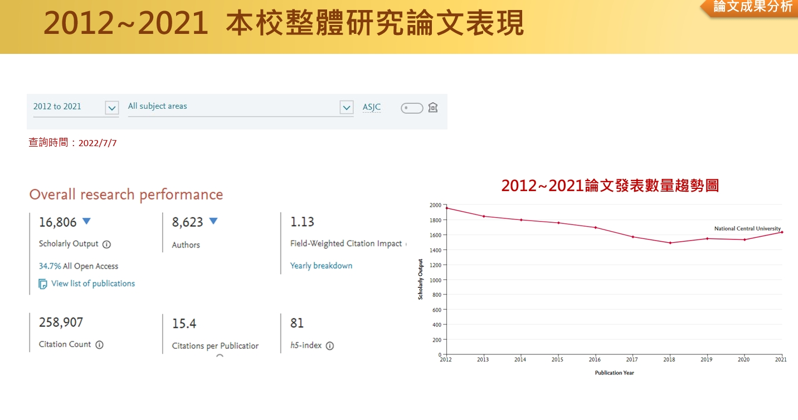
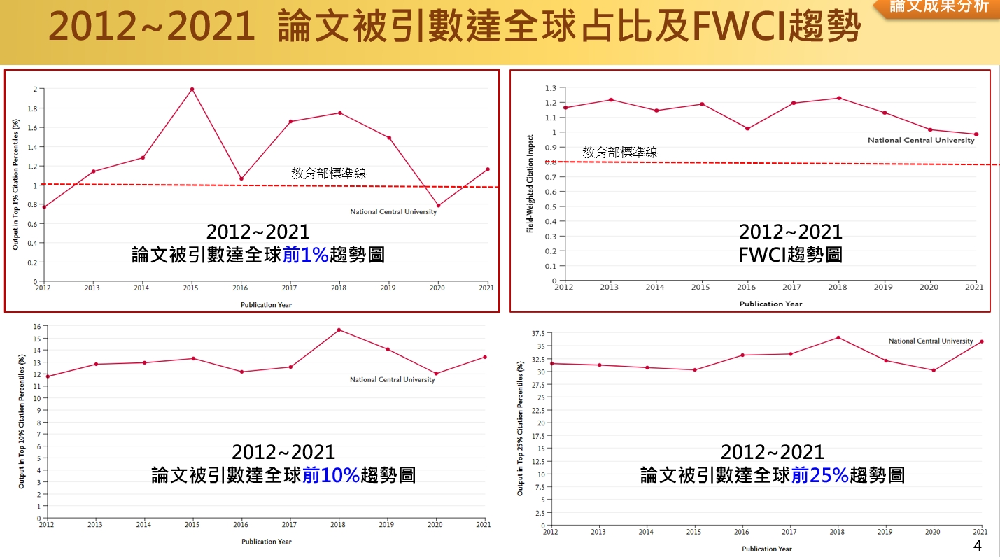
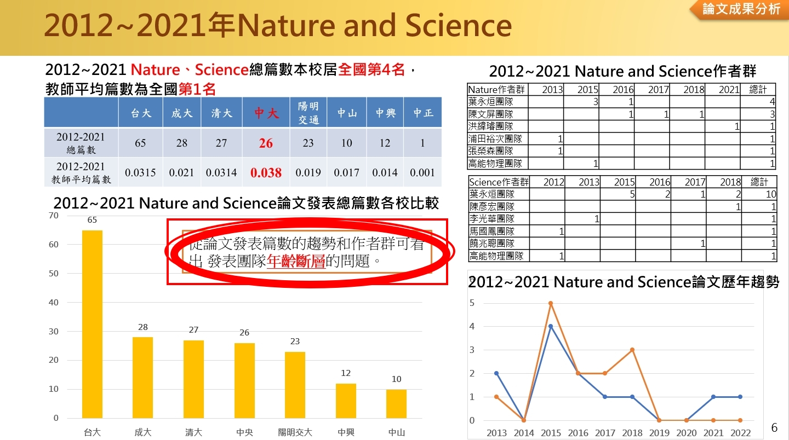
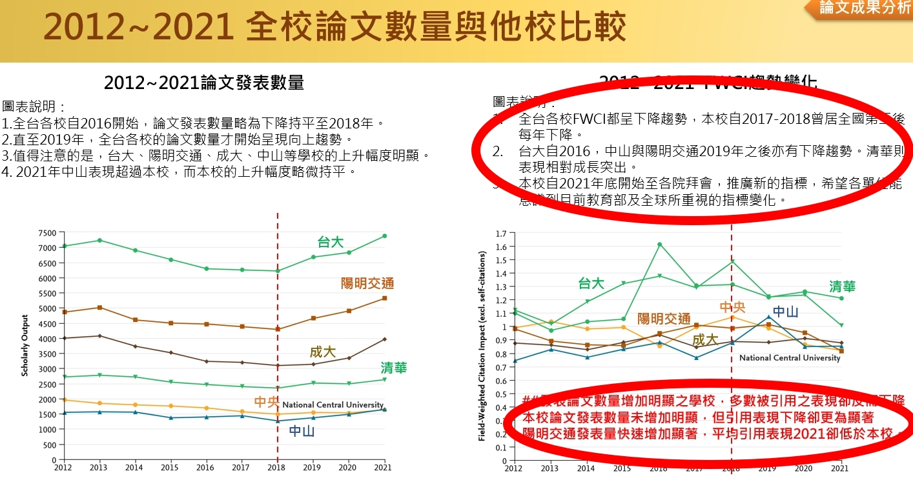
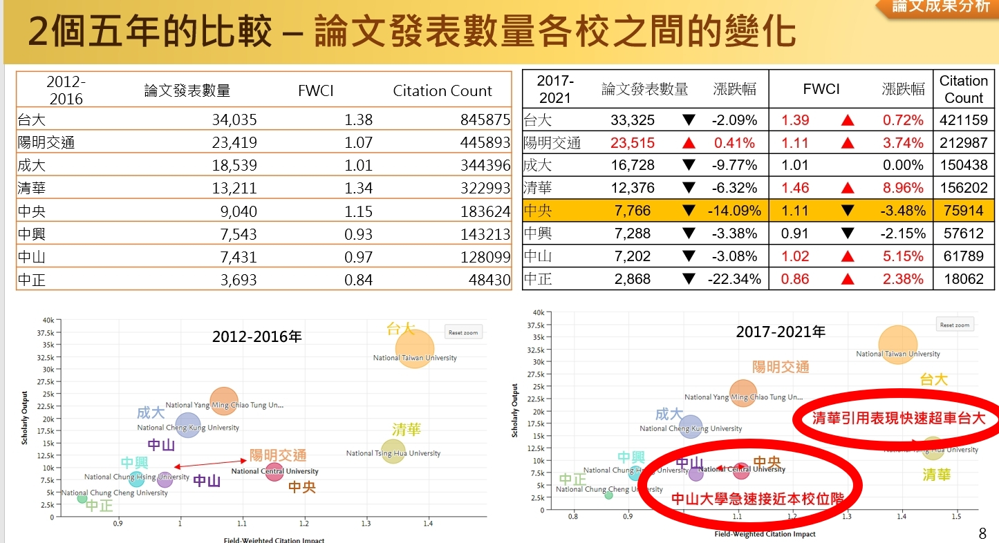
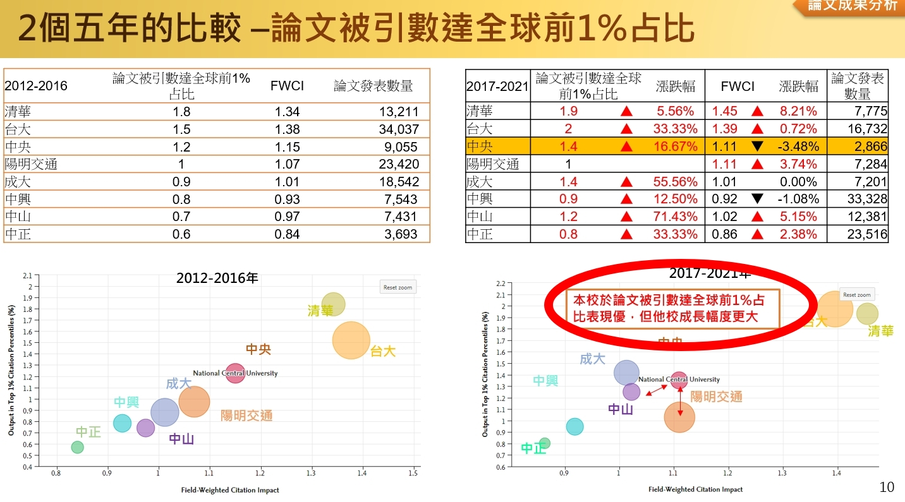

# 逐年趨勢與圖表：研發處過往簡報能做到哪些（2026-11-23）

研發處已確認要做逐年趨勢（第 13 題）。本文件逐張檢查研發處過往簡報（[研發處過往簡報/](../reference/研發處過往簡報/)，內容分析見 [2026-11-21-研發處簡報分析](../reference/2026-11-21-研發處簡報分析.md)）中的圖表，說明系統用現有資料能不能做、還缺什麼，以及建議的做法。

> **更新（2026-11-23）**：第一階段（系所層級逐年趨勢）已實作，見第六節；全校層級需要的準備見第七節。

---

## 一、結論

過往簡報的 9 頁中，第 1～6 頁有圖，第 7～9 頁是文字與表格。

| 頁 | 圖表 | 系所層級 | 全校層級 | 說明 |
|---|---|---|---|---|
| 1 | 整體指標總覽（論文數、作者數、FWCI、被引數、平均被引、h5-index） | ⚠️ 大部分可以 | ⚠️ 需機構層級 API | 作者數、h5-index 沒有資料 |
| 1 | 逐年論文數線圖 | ✅ | ⚠️ 需機構層級 API | |
| 2 | 逐年 Top 1%／10%／25% 線圖 + 教育部標準線 | ✅ | ⚠️ 需機構層級 API | 要決定畫占比（%）還是篇數，見第四節 |
| 2 | 逐年 FWCI 線圖 + 教育部標準線 | ✅ | ⚠️ 需機構層級 API | |
| 3 | Nature／Science 各校篇數長條圖、歷年趨勢 | ✅ 資料已有 | ⚠️ | 第 14 題決議先不做 |
| 3 | Nature／Science 作者群（研究團隊）× 年度表 | ❌ | ❌ | 沒有作者資料；「年齡斷層」這類判斷要人來下 |
| 4 | 各校逐年論文數線圖（本校 vs 對標學校） | ✅ | ⚠️ 需機構層級 API | 系所層級是「本系所 vs 對標系所」 |
| 4 | 各校逐年 FWCI（排除自我引用）線圖 | ⚠️ | ⚠️ 需機構層級 API | 系統的 FWCI 含自我引用，見第三節 |
| 4 | 圖上的分隔線（2018） | ✅ | ✅ | 純粹是畫圖的功能 |
| 5、6 | 兩期比較表（數值、漲跌幅、▲▼） | ✅ 已可做 | ⚠️ | 現在用「與前期比較」選前一期分析即可 |
| 5、6 | 兩期泡泡圖（x = FWCI，y = 論文數或 Top 1%，大小 = 被引數） | ✅ | ⚠️ 需機構層級 API | |

**簡單說**：過往簡報的圖幾乎都是**全校層級**，系統目前是**系所層級**。同樣的圖換成「本系所 vs 對標系所」，大部分**用已經抓到的資料就能畫，不需要再花 API 額度**，舊的分析也能補畫。要做到跟過往簡報一模一樣的全校圖，需要先做全校層級（實作計畫第五節的 SciVal 機構層級 API）。

---

## 二、逐張說明

### 第 1 頁：本校整體研究論文表現

- **總覽數字**：系所層級可算出論文數、FWCI、被引數、平均被引次數；**作者數（Authors）、h5-index 沒有資料**（系統沒有抓作者，也沒有逐篇被引的時間序列）。
- **逐年論文數線圖**：每篇論文都存了出版年，按年份計數即可。

### 第 2 頁：被引數達全球占比及 FWCI 趨勢

- **Top 1%、Top 10%**：系統已逐篇判斷，按年份計數即可。
- **Top 25%**：系統目前沒有用到這個門檻，但 SciVal 回應中已經有，且整份回應都存在資料庫，**不用重抓**。注意它跟系統的「Q1」不同：Q1 是期刊 CiteScore 排名前 25%，這裡是論文被引數在全球前 25%。
- **FWCI**：逐年平均各篇 FWCI。
- **教育部標準線**：圖上畫一條水平虛線即可（過往簡報約為 Top 1% 1%、FWCI 0.8）。數值與來源要跟研發處確認，也要確認是否適用於系所層級。

### 第 3 頁：Nature and Science

- **篇數、長條圖、歷年趨勢**：SciVal 回應中有每篇的期刊名稱（`sourceTitle`），可以挑出 Nature、Science，資料已有。
- **作者群表**：要知道每篇屬於哪個研究團隊，需要另外抓作者資料（Scopus 作者欄位），目前完全沒有。
- 第 14 題已決議「頂刊、千人作者論文先不做」，這頁列為之後再評估。

### 第 4 頁：全校論文數量與他校比較

- **各校逐年論文數**：系所層級改成「本系所與各對標系所」，每條線一所學校，資料都已存在。
- **各校逐年 FWCI（排除自我引用）**：SciVal 的逐篇 FWCI **一律含自我引用**（`includeSelfCitations` 對逐篇指標無效，見 README），系統目前也只排除了被引次數中的自我引用。可以畫含自我引用的 FWCI 並在圖上註明，或等全校層級改用機構層級 API 時再取排除後的數字。
- **分隔線、學校名稱標在線尾**：都是畫圖的功能，可以做。

### 第 5、6 頁：兩個五年的比較

- **兩期比較表**：現在就能做：先跑前一期（例如 2016–2020），在 AI 總結選它當前期，漲跌幅由程式計算。要做成簡報上的表格頁，需要新增版面。
- **泡泡圖**：每所學校（系所）一個泡泡，x 軸 FWCI、y 軸論文數（第 5 頁）或 Top 1%（第 6 頁）、泡泡大小為被引數，兩期各一張。資料都有。
- **限制**：SciVal 的期間起始年不能早於 10 年前，兩期加起來最多 10 年。

---

## 三、資料面的限制

| 項目 | 說明 |
|---|---|
| **不需重抓** | 逐年數字都能從已存的逐篇資料算出（出版年、Q1、Top 1%／10%／25%、FWCI、國際合著、被引數、期刊名稱），不花 API 額度，舊分析也能補畫 |
| **年數** | 一次分析最多 10 年（SciVal 限制）。要畫 10 年趨勢，分析期間就要設 10 年 |
| **最近一兩年的被引指標偏低** | 新論文還來不及被引用，Top 1%／10%、平均被引次數在最近一兩年一定偏低，看起來像「下滑」。過往簡報 2020、2021 年的下降可能也有這個成分。建議圖上加註，或讓研發處決定是否只畫到前兩年 |
| **FWCI 的自我引用** | 逐篇 FWCI 含自我引用，與過往簡報第 4 頁「excl. self-citations」不同 |
| **逐年師均** | 系統的師均用單一學年度的教師數。逐年師均要每一年的教師數：教育部檔案可以一次下載多個學年度，但學年度（8 月起）跟論文的出版年（1 月起）對不齊，要決定怎麼對應 |
| **沒有的資料** | 作者、作者數、h5-index、千人作者論文；全校合計（系所加總會重複計算跨系合著，不能直接相加） |

---

## 四、要跟研發處確認的事

1. **要看哪些指標的趨勢？** 建議：論文數、Q1、Top 1%、Top 10%、國際合著、FWCI。
2. **畫篇數、師均還是占比（%）？** 第 3 題決議被引表現「只呈現師均篇數，不做占比」，但過往簡報的趨勢圖用的是占比。趨勢圖要沿用師均，還是畫逐年篇數就好？（逐年師均的困難見第三節）
3. **要不要 Top 25%？** 過往簡報有，系統目前的指標沒有。
4. **期間**：趨勢看 5 年還是 10 年？
5. **教育部標準線**：數值與出處（Top 1% 1%、FWCI 0.8？），系所層級也適用嗎？
6. **最近一兩年**：被引相關指標要不要加註，或不畫？
7. **放在哪裡、預設要不要出現？** 現在的主管偏好表格。建議趨勢圖做成系所簡報中的一章，在分析設定中勾選才產生。
8. **全校層級**：第 1、2、4 頁的原圖都是全校。要做到一樣，需要先做全校層級（第 12 題，先前決議先不做）。

---

## 五、建議做法（待確認後再實作）

**第一階段：系所層級逐年趨勢**（預估 2～3 天）
- 從已存的逐篇資料算出逐年數字，舊分析也適用
- 系所簡報新增「逐年趨勢」章：每個指標一張線圖，本系所與各對標系所各一條線，本系所用紅色加粗，可加標準線
- 使用 PowerPoint 原生圖表（python-pptx 支援線圖、長條圖、泡泡圖），研發處拿到後可以在 PowerPoint 裡直接改顏色、標註
- 網頁結果頁加一個「趨勢」分頁顯示同樣的圖；Excel 加一張逐年數字的工作表，方便核對
- AI 總結的輸入資料加入逐年數字，就能寫出像過往簡報第 4 頁「2021 年中山表現超過本校」這類句子

**第二階段：兩期比較頁**（預估 1～2 天）
- 選定前期分析後，簡報加入第 5、6 頁的兩期比較表（漲跌幅、▲▼、本系所整列標色）與泡泡圖

**第三階段：全校層級**（實作計畫第五節，預估 3～5 天）
- 改用 SciVal 機構層級 API，可以直接取得逐年數字，第 1、2、4 頁的原圖都能重現
- 開始前要先確認學校的 Key 是否開放機構層級 API，以及 8 所學校的 SciVal 機構 ID

**之後再評估**
- Nature／Science 篇數（資料已有，等第 14 題決定）
- 作者群、千人作者論文、h5-index（需要新的資料來源）

**不在範圍內**：第 7 頁的各校獎勵措施（不是論文數據）、需要校內背景知識的判斷（例如「年齡斷層」）。

---

## 六、第一階段實作（系所層級，2026-11-23）

第四節的問題還沒跟研發處確認，先用以下預設實作，之後要改都只動少數地方：

| 問題 | 先採用 | 要改時 |
|---|---|---|
| 1. 指標 | 論文數、Q1、Top 1%、Top 10%、國際合著、FWCI | `app/reports/trends.py` 的 `TREND_INDICATORS` |
| 2. 篇數、師均或占比 | **逐年篇數**（不除以教師數）；FWCI 為該年平均 | 要師均得先決定學年度與出版年怎麼對應 |
| 3. Top 25% | 不做 | 資料已在 SciVal 回應中，要做時加一個指標 |
| 4. 期間 | 跟分析期間相同（5 年或 10 年） | — |
| 5. 教育部標準線 | 不畫 | 數值確認後在線圖加一條水平線 |
| 6. 最近一兩年 | 照畫，Top 1%、Top 10%、FWCI 的圖加註「被引次數還在累積」 | — |
| 7. 放在哪裡 | 結果頁新增「逐年趨勢」分頁；系所簡報**預設不加**，在該分頁按「放入系所簡報」才加 | 設定 `report_trends` |

**做了什麼**
- 逐年數字：依論文出版年分組，從已存的逐篇資料計算（`app/reports/trends.py`），不呼叫 API，舊分析也適用。各年篇數加總等於整個期間的篇數（有測試）
- 網頁：「逐年趨勢」分頁，一次顯示一個比較群組（對標學校或院內），每個指標一張線圖與逐年數字表
- 簡報：開啟後在各指標之後加一章「逐年趨勢」，每個指標一頁，左邊對標學校、右邊院內系所，各一張 PowerPoint 原生線圖；本系所紅色加粗，其他單位用不含紅色的配色。AI 總結章的編號順延
- Excel：新增「逐年趨勢」工作表

**還沒做**
- AI 總結的輸入加入逐年數字：輸入一改，所有已產生的 AI 總結都會被標成「可能過時」，等研發處確認要哪些指標後再一起加
- 第二階段（兩期比較頁、泡泡圖）

---

## 七、全校層級需要什麼

過往簡報第 1、2、4 頁是「本校 vs 他校」的全校數字。系所數字**不能加總成全校**（跨系合著會重複計算，也有不屬於任何系所的論文），所以全校要另外取資料。有兩條路：

| | A. SciVal 機構層級 API | B. 沿用現有流程，查詢條件改成整個學校 |
|---|---|---|
| 做法 | 直接向 SciVal 要各校的逐年指標 | 用 Scopus 機構代碼（AF-ID，系統已會自動查）查出全校論文，再逐篇取 SciVal 指標 |
| API 用量 | 很少（每校每個指標幾次請求） | 很大：一所大學 5 年約上萬篇，8 校可能 10 萬篇以上，逐篇指標每 100 篇 1 次請求 |
| 排除自我引用 | 機構層級可能可以直接排除（第 4 頁要的「excl. self-citations」），要實測 | 逐篇抓參考文獻在這個規模做不到，只能不排除或用「只用 Scopus Search」模式 |
| 可以點進去看逐篇明細 | 不行，只有彙總數字 | 可以 |
| 程式改動 | 新的 API 呼叫、新的資料表（各校逐年數字）、新的結果頁與簡報 | 主要是新增「全校」比較範圍，其餘沿用 |

**建議走 A**。開始前要先確認或準備：

1. **API 權限**：學校的 Key 能不能呼叫 SciVal Institution 端點（用一所學校實測一次即可）
2. **SciVal 機構 ID**：每所學校在 SciVal 的機構 ID（跟 Scopus 的 AF-ID 不同），需要查一次並存起來，做法類似現有的 AF-ID 對照
3. **實測可取得的指標**：論文數、FWCI、Top 1%／10%／25%、國際合著、被引數是否都能逐年取得；排除自我引用的 FWCI 是否有效；作者數、h5-index 有沒有
4. **研發處要決定的事**
   - 全校要比哪幾所學校？過往簡報第 8 頁用了台科、台師大，跟 mapping 表的對標學校不同，可能需要另一份「全校對標學校」清單
   - 要不要師均？要的話需要各校**全校**專任教師數（教育部有全校層級的統計，跟現在匯入的系所檔不同）
   - 期間與教育部標準線（同第四節第 4、5 題）
5. **產出**：一份獨立的「全校論文表現」簡報（第 1、2、4 頁的版面），不放在系所簡報裡

預估 3～5 天，其中實測 API 與查機構 ID 約 1 天；第 1 點不通的話只能走 B，或請研發處從 SciVal 網頁匯出。
