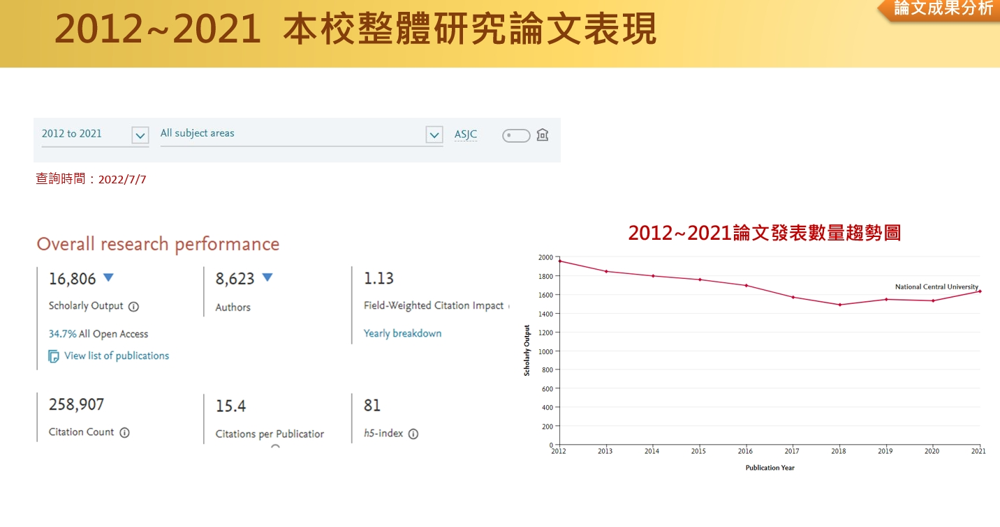
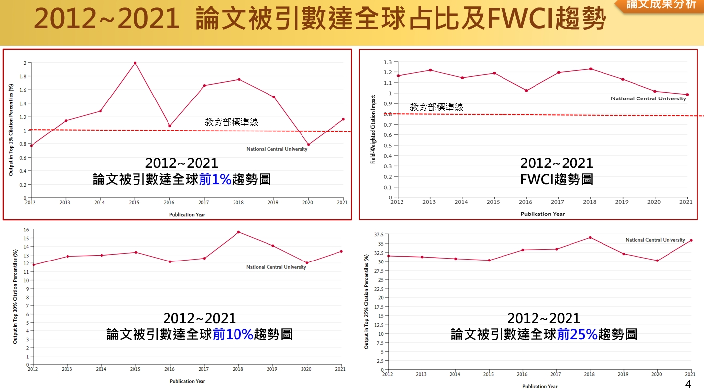
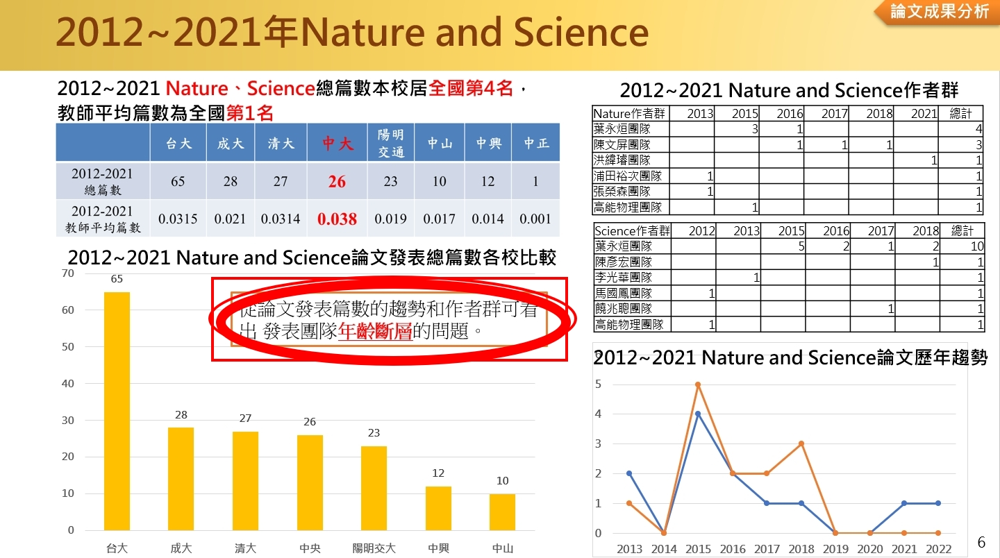
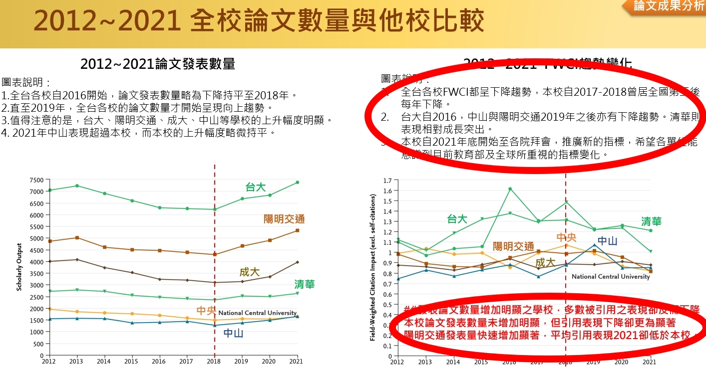
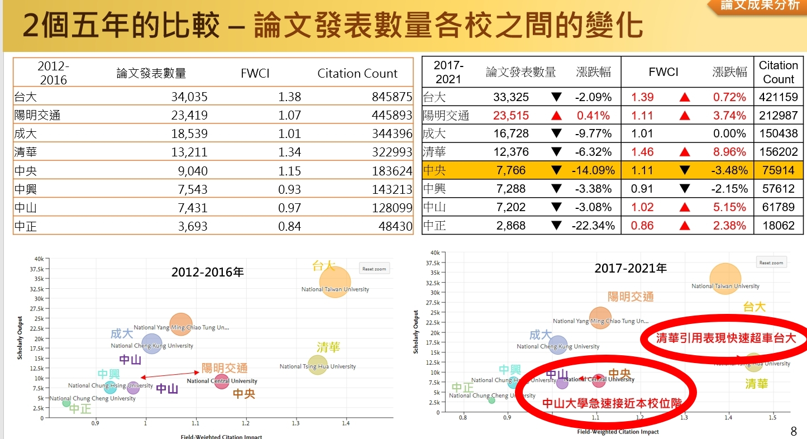
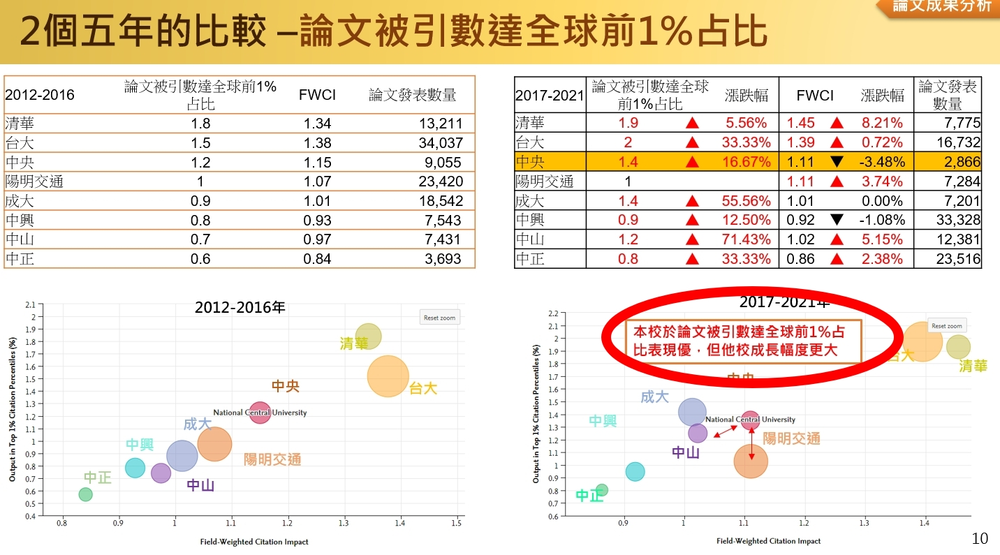
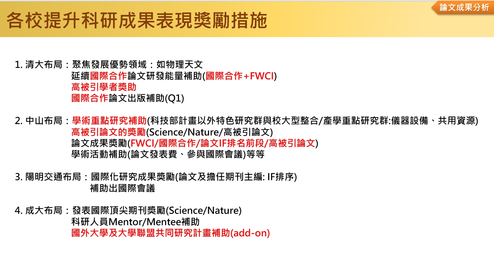
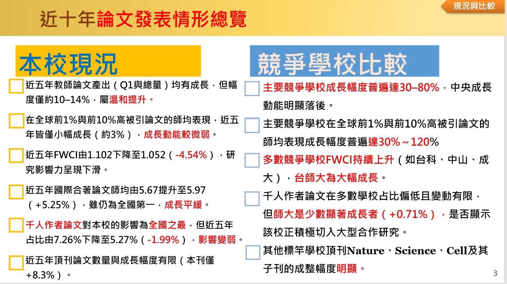
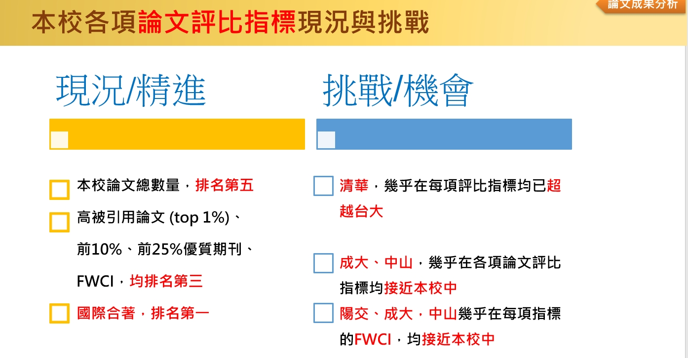

# 研發處過往論文成果分析簡報：分析與系統對照（2026-11-21）

研發處承辦人在 LINE 上提供了她過去做的全校論文成果分析簡報（共 9 頁，截圖放在 [研發處過往簡報/](研發處過往簡報/)），希望 AI 產出的分析能「跟她做得差不多」，語氣也參考她的寫法。

本文件逐頁分析這些簡報：用了哪些資料、從數據中看出什麼、怎麼寫結論；再對照系統目前做得到的部分，並列出要跟研發處確認的事。

---

## 一、她的需求重點（LINE 對話）

- AI 的建議要**建立在量化數據上**；目前系統完成的是量化數據的呈現。
- 以前的主管喜歡看線圖，**現在的主管喜歡看數據**（表格）。
- 希望 AI 能**從數據中看出問題，寫進簡報**（像她簡報上紅圈標出來的註解）。
- 最基本的：請 AI **分析中大各系所的位置：贏過哪些學校、被哪些學校超越**。她自己說這還不到策略分析，只要針對數據說明。
- 要**凸顯本校的優勢**。
- 「各校獎勵措施」那種綜整分析和策略建議，她自己也覺得 AI 不一定做得到。

---

## 二、逐頁分析

### 第 1 頁：2012~2021 本校整體研究論文表現

| 項目 | 內容 |
|---|---|
| 分析單位 | **全校** |
| 期間 | 10 年（2012–2021） |
| 資料 | SciVal Overview 截圖：Scholarly Output 16,806、Authors 8,623、FWCI 1.13、Citation Count 258,907、Citations per Publication 15.4、h5-index 81；另附逐年論文數趨勢線圖 |
| 結論寫法 | 這頁沒有文字結論，只呈現數據，並註明查詢時間 |

### 第 2 頁：論文被引數達全球占比及 FWCI 趨勢

| 項目 | 內容 |
|---|---|
| 分析單位 | 全校 |
| 資料 | 逐年的 Top 1%、Top 10%、Top 25% 被引**占比（%）**，以及逐年 FWCI |
| 特色 | 畫了**教育部標準線**（Top 1% 約 1%、FWCI 0.8），一眼就看得出哪幾年低於標準 |
| 結論寫法 | 沒有文字；Top 1% 和 FWCI 兩張圖用紅框框起來強調 |

### 第 3 頁：2012~2021 年 Nature and Science

| 項目 | 內容 |
|---|---|
| 資料 | 各校 Nature、Science 總篇數與教師平均篇數、各校比較長條圖、本校作者群（研究團隊）× 年度的篇數表、歷年趨勢線圖 |
| 結論寫法 | 標題直接下結論：「總篇數本校居**全國第 4 名**，教師平均篇數為**全國第 1 名**」（紅字）。紅圈註解：「從論文發表篇數的趨勢和作者群可看出發表團隊**年齡斷層**的問題」 |
| 觀察 | 「年齡斷層」這個結論需要知道各團隊主持人的資歷，**數據本身推不出來**，是承辦人自己的判斷 |

### 第 4 頁：2012~2021 全校論文數量與他校比較

| 項目 | 內容 |
|---|---|
| 資料 | 6 校逐年論文數線圖、6 校逐年 FWCI（排除自我引用）線圖；2018 年畫一條分隔線 |
| 結論寫法 | 「圖表說明」用編號條列，例如「全台各校自 2016 開始，論文發表數量略為下降持平至 2018 年」「2021 年中山表現超過本校，而本校的上升幅度略微持平」 |
| 紅圈重點 | 「全台各校 FWCI 都呈下降趨勢，本校自 2017–2018 曾居全國第二後每年下降」「發表論文數量增加明顯之學校，多數被引用之表現卻相對下降」「本校論文發表數量未增加明顯，但引用表現下降卻更為顯著」「陽明交通發表量快速增加顯著，平均引用表現 2021 卻低於本校」 |
| 觀察 | 這頁是**最典型的「從數據看出問題」**：比較各校的趨勢方向、找出被超越的時間點，並把發表數量和引用表現交叉比對 |

### 第 5 頁：2 個五年的比較：論文發表數量各校之間的變化

| 項目 | 內容 |
|---|---|
| 資料 | 2012–2016 和 2017–2021 兩期的 8 校表格：論文數、FWCI、Citation Count，後期附**漲跌幅**與 ▲▼；兩期泡泡圖（x 軸 FWCI、y 軸論文數、泡泡大小為被引數） |
| 標示 | 中央那一列整列標黃；上升的數字用紅字 |
| 紅圈重點 | 「清華引用表現快速超車台大」「中山大學急速接近本校位階」 |

### 第 6 頁：2 個五年的比較：論文被引數達全球前 1% 占比

| 項目 | 內容 |
|---|---|
| 資料 | 同上的兩期表格，改看 Top 1% 占比、FWCI、論文數；兩期泡泡圖 |
| 紅圈重點 | 「本校於論文被引數達全球前 1% 占比表現優，但他校成長幅度更大」 |
| 觀察 | 典型句型是**「本校 X 表現優，但他校成長幅度更大」**：先肯定優勢，再點出威脅 |

### 第 7 頁：各校提升科研成果表現獎勵措施

| 項目 | 內容 |
|---|---|
| 資料 | 清大、中山、陽明交通、成大的獎勵與補助政策，例如國際合作論文補助、高被引學者獎勵、Science/Nature 獎勵 |
| 觀察 | 資料來自各校的政策文件，**不是論文數據**，系統和 AI 都產生不了。承辦人自己也說 AI 可能做不到 |

### 第 8 頁：近十年論文發表情形總覽（本校現況 vs 競爭學校比較）

| 項目 | 內容 |
|---|---|
| 版面 | **左右兩欄**：左欄黃色「本校現況」，右欄藍色「競爭學校比較」，每點前面有 □ |
| 左欄寫法 | 「近五年教師論文產出（Q1 與總量）均有成長，但幅度僅約 10–14%，屬**溫和提升**」「近五年 FWCI 由 1.102 下降至 1.052（**-4.54%**），研究影響力呈現下滑」「國際合著論文師均由 5.67 提升至 5.97（+5.25%），雖仍為全國第一，**成長平緩**」「**千人作者論文**對本校的影響為**全國之最**，但近五年占比由 7.26% 下降至 5.27%，**影響變弱**」 |
| 右欄寫法 | 「主要競爭學校成長幅度普遍達 **30–80%**，中央成長動能明顯落後」「**多數競爭學校 FWCI 持續上升**（如台科、中山、成大），台師大為大幅成長」「其他標竿學校頂刊 Nature、Science、Cell 及其子刊的成長幅度明顯」 |
| 觀察 | 這一頁的競爭學校有台科、台師大，跟第 5、6 頁的 8 校不同，可見**對標學校會依分析目的調整** |

### 第 9 頁：本校各項論文評比指標現況與挑戰

| 項目 | 內容 |
|---|---|
| 版面 | 左右兩欄：左「現況／精進」（黃），右「挑戰／機會」（藍），□ 條列，重點用紅字 |
| 左欄 | 「本校論文總數量，**排名第五**」「高被引用論文（top 1%）、前 10%、前 25% 優質期刊、FWCI，**均排名第三**」「國際合著，**排名第一**」 |
| 右欄 | 「清華，幾乎在每項評比指標均已**超越台大**」「成大、中山，幾乎在各項論文評比指標均**接近本校中**」「陽交、成大、中山幾乎在每項指標的 FWCI，均**接近本校中**」 |
| 觀察 | **用的全是名次和學校之間的相對位置**，這正是她要 AI 做的「贏過誰、被誰超越」。系統目前的資料就足以寫出這一頁 |

---

## 三、她的寫作風格（給 AI 的語氣依據）

1. **肯定句、直接下結論**：「排名第五」「研究影響力呈現下滑」「成長動能明顯落後」，不寫「仍有成長空間」這種委婉說法。
2. **每句都有數字**：名次、前後兩期的數值、漲跌幅（-4.54%、+5.25%）。
3. **直接點名其他學校**：「清華超越台大」「中山急速接近本校位階」「陽明交通平均引用表現低於本校」。
4. **先優勢、後威脅**：「雖仍為全國第一，成長平緩」「表現優，但他校成長幅度更大」。
5. **交叉比對兩個指標**：論文數增加但引用下降，或量少但 FWCI 高。
6. **固定的描述詞**：溫和提升、成長動能較微弱、呈現下滑、影響變弱、明顯落後、急速接近、超越、超車。
7. **版面**：兩欄對照（黃／藍）、□ 條列、紅字標重點、紅圈註解。

> 她的語氣幾乎都是肯定句。AI 產出的頁面會在底部註明「※本頁由 AI 依系統數據統整，內容不一定準確，請進一步確認」，所以 AI 也可以照這種肯定的寫法來寫。

---

## 四、跟系統目前的對照

| 她的簡報 | 系統目前 | 能否做到 |
|---|---|---|
| **第 9 頁**：各指標名次、贏過誰、被誰超越、誰在接近 | 每個系所在對標學校中的名次與數值都有 | ✅ **資料已足夠**，只要改 AI 的輸入資料與 prompt（目前 AI 只看得到本系所自己的數字，看不到其他學校） |
| **第 5、6 頁**：兩個五年的比較、漲跌幅、誰超車 | 可以先跑前一期（例如 2016–2020），在「與前期比較」選它當基準 | ✅ 可以做；漲跌幅由程式算好再交給 AI。受 SciVal「起始年不能早於 10 年前」限制 |
| **第 8 頁**：本校現況 vs 競爭學校比較（兩欄） | 同上 | ✅ 大部分可以做；但「千人作者論文」「Nature/Science/Cell 頂刊」系統沒有這些指標 |
| 兩欄、□、紅字的版面 | AI 頁目前是單欄條列 | ✅ 可以做（改簡報版面） |
| **第 2、4 頁**：**逐年**趨勢線圖、教育部標準線 | 系統只算 5 年合計，沒有逐年數字 | ⚠️ 需要新增逐年資料（SciVal API 應可取逐年數值，待確認）。現在的主管偏好看表格，優先度較低 |
| 第 2 頁：Top 1%／10%／25% **占比（%）** | 系統算的是 Top 1%、10% 的**師均篇數**；Q1 是期刊排名前 25%，跟「被引前 25%」不同 | ⚠️ 指標定義不同，需確認要用哪一種 |
| **第 1、4 頁**：**全校**層級 | 系統的分析單位是系所，沒有全校合計 | ⚠️ 要確認研發處要不要全校層級的分析 |
| **第 3 頁**：Nature/Science 篇數與作者群 | 沒有 | ⚠️ 需要另外查期刊與作者資料；「年齡斷層」這類判斷需要人來下 |
| **第 7 頁**：各校獎勵措施 | 沒有 | ❌ 不是論文數據，AI 不應該憑空寫；由承辦人整理 |

---

## 五、建議做法

**第一階段（用現有資料就能做，最貼近她的需求）**
- AI 頁改成第 9 頁的版面：「現況／優勢」對「挑戰／機會」兩欄，寫出名次、贏過哪些學校、被哪些學校超越、哪些學校在接近。
- 有前期資料時加一頁，照第 8 頁的寫法：「本系所變化」對「競爭學校變化」，附漲跌幅。
- 語氣改成她的肯定句寫法，重點用紅字標出，頁面底部加 AI 註記。
- 系所簡報和全院總結簡報都套用這個版面。

**第二階段（要新增資料）**
- 逐年數據：做趨勢分析和線圖，例如「哪一年被超越」「教育部標準線」。
- 被引占比（%）指標、Top 25%。

**第三階段（視研發處需求）**
- 全校層級的分析。
- Nature／Science／Cell 頂刊、千人作者論文。

**不在範圍內**：各校獎勵措施、需要校內背景知識的判斷（例如年齡斷層）。

---

## 六、要跟研發處確認的事

1. AI 分析要做在**系所層級**（每個系所一頁），還是也要**全校層級**（像這份簡報）？
2. 被引表現要用系統目前的**師均篇數**，還是她簡報上的**占比（%）**？
3. 需不需要**逐年趨勢**？還是兩期比較就夠了？
4. 對標學校：第 8 頁用到台科、台師大，跟系所 mapping 表的對標學校不同；全校層級的分析要比哪幾所學校？
5. AI 頁底部的註記「※本頁由 AI 依系統數據統整，內容不一定準確，請進一步確認」，這樣寫可以嗎？
