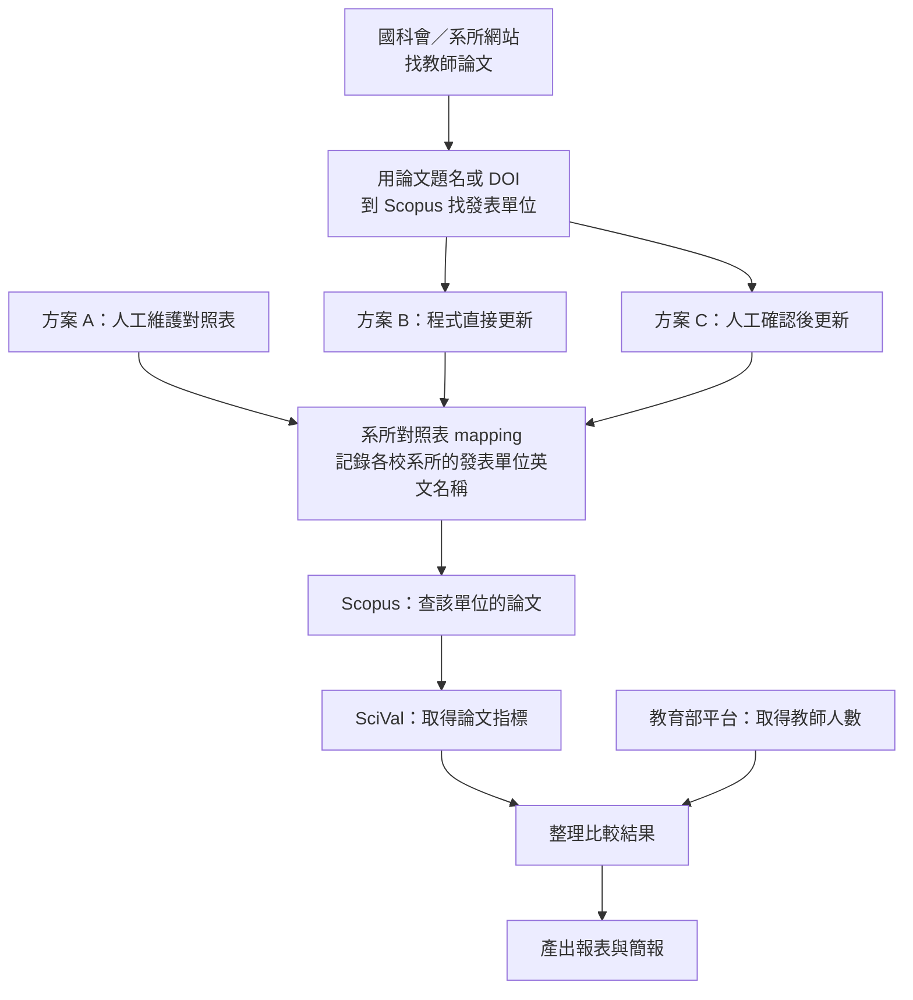

# 論文資料自動化：會議討論

## 一、架構圖

**如果現有對照表可以直接使用，就能走方案 A，省下前面找教師論文、查發表單位名稱的步驟。** 表內缺漏或有疑問的資料，仍需先確認。

方案 B、C 才需要讓程式自動找名稱。建議優先用「論文題名或 DOI（論文識別碼）」比對，減少教師英文姓名縮寫、拼法不同造成的問題；找到論文後，也要確認取到的是該教師的單位。

圖中後半段能否全自動，還要確認 Scopus、SciVal 及教師人數資料的取得方式。

## 二、各方案比較

| 方案 | 怎麼做 | 優點 | 要注意的事 |
| --- | --- | --- | --- |
| **A：人工維護，程式查詢** | 人工提供正確的對照表，程式接手查論文、整理指標及產出成果。 | 開發較單純，資料有問題時容易確認與修正。 | 對照表仍要有人維護，不是全部自動。 |
| **B：程式自動維護** | 程式定期找教師論文、辨識發表單位，再更新對照表。 | 目標是減少人工維護，讓整個流程自動執行。 | 開發較難，可能認錯作者或單位；無法判定時如何處理，要先說好。 |
| **C：程式查找，人工確認** | 程式先找出新名稱或變更，再由人工確認後更新。 | 減少人工查找，也保留確認正確性的機會。 | 仍需有人確認，無法完全無人操作。 |

**建議先做 A，讓例行工作先自動化；之後有需要再增加 C。** 如果一定要做 B，就先挑幾個系所試跑，確認辨識結果是否可靠，再決定擴大範圍。

## 三、待確認問題

| 問題 | 會議要確認什麼 |
| --- | --- |
| **1. 現有 mapping 表可以當基準嗎？** | 委託人是否認可表內對應？空白、`X` 及有疑問的名稱由誰補充或確認？中央大學自己的發表單位名稱也需要準備。 |
| **2. 一定要完全自動嗎？** | 可以接受人工維護對照表，或只確認程式找出的新資料嗎？這會直接影響方案與開發難度。 |
| **3. 程式找不準時怎麼辦？** | 找不到論文、同名作者、教師轉校或單位改名時，要交人工確認，還是先列為待處理？不能直接當成零篇。 |
| **4. 能取得哪些 API 權限？** | 請負責人與廠商確認 Scopus 和 SciVal 是否都能提供本案所需功能、使用權限及額度；若暫時不行，能否先人工匯出檔案給程式整理？ |
| **5. 第一版要做到哪裡？** | 先做哪些系所與對標學校？需要哪些指標？教師人數用哪個年度、能否人工修改？最後報表與簡報要長什麼樣子？ |
